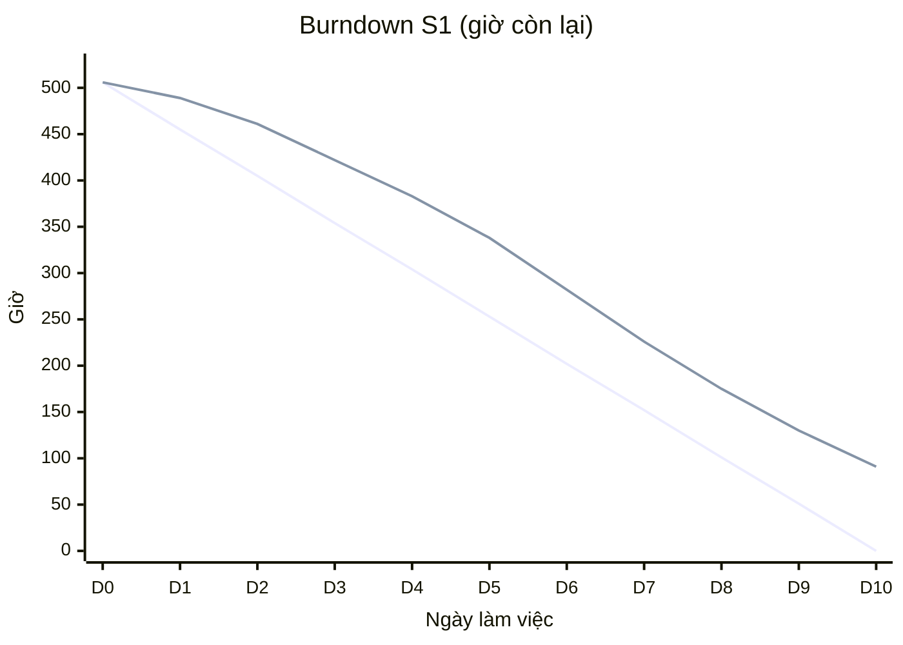

# Báo cáo tiến độ — Sprint S1 (2026-12-07 → 2026-12-18) — GIẢ LẬP

> Bài thực hành LAB-5. Sprint chưa diễn ra thật; trạng thái trên board được cập nhật theo kịch bản `backlog/sprint-s1-simulation.json` để mô phỏng kết thúc sprint. Mọi con số dưới đây đọc trực tiếp từ GitHub Project (trường Status, Iteration, Hours), không nhập tay.

## 1. Tóm tắt

- **Kế hoạch:** 80 việc · 506 giờ (SWP × 1,85).
- **Hoàn thành:** 65 việc · 415 giờ (**82%** giờ kế hoạch).
- **Đang làm:** 8 việc · 50 giờ · **Chưa bắt đầu:** 7 việc · 41 giờ → chuyển sang S2.
- **Đánh giá:** nền tảng (thứ tự khóa, idempotency, bảng quy tắc có version, audit, catalog mã) đã xong — đúng mục tiêu S1. Trễ tập trung ở đăng nhập Entra ID (chờ thông tin tenant của khách), phân vùng DB (lỗi thiết kế GAP-00-05) và khung batch.

## 2. Trạng thái theo vai

| Vai | Giờ kế hoạch | Giờ xong | % |
|---|---:|---:|---:|
| BE | 212 | 196 | 92% |
| BrSE | 24 | 14 | 60% |
| FE | 26 | 18 | 71% |
| Infra | 33 | 28 | 83% |
| QA | 134 | 103 | 77% |
| SA | 76 | 56 | 73% |

## 3. Burndown (giờ còn lại)

Đường thứ nhất: lý tưởng. Đường thứ hai: thực tế (giả lập): 2 ngày đầu chậm do onboard +1 QA và môi trường Azure dev chưa ổn định; điểm cuối = giờ của các việc chưa Done trên Project (91 giờ, 18%).

| Ngày | D0 | D1 | D2 | D3 | D4 | D5 | D6 | D7 | D8 | D9 | D10 |
|---|---:|---:|---:|---:|---:|---:|---:|---:|---:|---:|---:|
| Lý tưởng | 506 | 455 | 405 | 354 | 304 | 253 | 202 | 152 | 101 | 51 | 0 |
| Thực tế | 506 | 489 | 461 | 422 | 383 | 338 | 282 | 226 | 175 | 130 | 91 |

## 4. Việc trễ (lý do đã ghi trên issue)

| Issue | Trạng thái | Lý do |
|---|---|---|
| #40 EP00-I11 Đăng nhập Entra ID có chọn 職務 trước và kiểm 職務 đượ | Đang làm | Chờ khách đăng ký app trên tenant Entra ID và chốt thời hạn token (Q-COM-07); phần chọn 職務 đã xong, phần OIDC chưa test được với tenant thật |
| #252 EP09-I08 Kết nối Entra ID (IF-IDP-01) | Đang làm | Cùng nguyên nhân EP00-I11: chưa có thông tin tenant / redirect URI của khách (ISS-11 mở rộng sang IdP) |
| #97 EP00-I26 Phân vùng tháng cho bảng lớn | Đang làm | Khi dựng phân vùng phát hiện đúng GAP-00-05: PK / UNIQUE thiếu cột phân vùng, phải sửa DB design (CR) trước khi chạy migration |
| #269 EP01-I01 Rà lại DD SCR-01 入荷検品 theo kiến trúc Azure | Đang làm | Rà DD SCR-01 xong 3/5 phần; phần khóa và idempotency chờ ADR thứ tự khóa mở rộng (GAP-00-04) |
| #101 EP00-I27 Dựng khung chạy batch trên Functions | Chưa bắt đầu | Infra dồn sức cho IaC Azure (không có skill IaC Azure, viết tay lâu hơn dự kiến); khung batch Functions dời sang S2 |
| #571 EP04-I01 Chỉnh DD SCR-07 cho hệ đích Azure và chốt tham số  | Chưa bắt đầu | Chưa bắt đầu: chờ quyết ISS-35 (CR H-6 khóa tài xế, GAP-04-01) — rủi ro đã biết, hạn quyết 11-16 bị lỡ trong kịch bản này |

## 5. Rủi ro trễ và hành động

| # | Rủi ro | Ảnh hưởng | Hành động | Người / hạn |
|---|---|---|---|---|
| R1 | Khách chưa cung cấp thông tin tenant Entra ID và thời hạn token (Q-COM-07) | Đăng nhập là nền của mọi màn; S2 không demo được luồng đăng nhập thật | Gửi khách danh sách thông tin cần (app registration, redirect URI, nhóm vai trò) kèm hạn 12-23; trong lúc chờ dùng tenant dev của Sun* để test | BrSE · 12-23 |
| R2 | GAP-00-05: bảng phân vùng có PK / UNIQUE thiếu cột phân vùng | Chặn migration các bảng lớn → trễ EP-05, EP-06 và PoC truy vết ≤ 60 giây | Lập CR sửa DB design (thêm cột phân vùng vào khóa), duyệt trong tuần đầu S2; PoC hiệu năng dời sang S3 | SA + Linh · 12-25 |
| R3 | ISS-35 (khóa tài xế, H-6) chưa quyết, lỡ hạn 11-16 | EP04-I01 chưa bắt đầu; engine giờ lái 2024 (S5) có nguy cơ trễ, đây là ràng buộc pháp lý | Đưa vào steering tháng 12; nếu chưa quyết trước S2 thì áp phương án khuyến nghị PA A và ghi rủi ro | PM + Linh · S2 ngày 1 |
| R4 | Infra quá tải (IaC Azure viết tay, không có skill) | Khung batch Functions dời S2; IF.1 ERP (S2) phụ thuộc | Tạm chuyển 0,5 BE sang hỗ trợ IaC trong S2; dùng template Bicep có sẵn của Microsoft | PM · S2 |
| R5 | S6 vẫn quá tải 135% sau khi cân (docs/sprint-capacity.md) | Có thể trễ G4 (03-19) | Theo dõi velocity S1–S2; nếu thực tế < 85% kế hoạch thì kéo 1 BE từ S4 hoặc dùng buffer 05-17 → 05-28 | PM · cuối S2 |

## 6. Kế hoạch S2

- Mang sang: 15 việc S1 chưa xong (91 giờ).
- Ưu tiên: hoàn tất đăng nhập Entra ID khi có thông tin tenant, CR phân vùng, khung batch, rồi E1 入荷 và ルール版 giờ lái.
- Velocity S1 (giả lập): dùng làm hệ số giờ thực tế / SWP cho lần chấm lại (thay hệ số 1,85 từ 5 mẫu).
